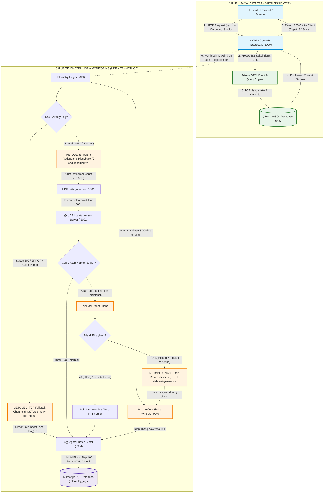

# Warehouse Management System (WMS) & Dual-Track Telemetry Ecosystem

Sistem Manajemen Pergudangan modern (*Enterprise Warehouse Management System*) terintegrasi dengan **Dual-Track Telemetry (UDP Log Aggregator)**, arsitektur microservices berbasis **Docker Compose**, dan antarmuka manajemen stok & outbound berbasis **React 19 + TypeScript**.

---

## 🏗️ Arsitektur Sistem Dual-Track

Ekosistem WMS dirancang untuk throughput tinggi, efisiensi alur data (*data flow efficiency*), dan latensi ultra-rendah melalui pemisahan dua jalur utama:
* **Jalur Utama (Data Bisnis & Transaksi - TCP/ACID)**: Menangani transaksi inventaris, inbound, outbound, dan pesanan penjualan dengan jaminan konsistensi data mutlak (ACID) dan respon cepat ke pengguna tanpa terhambat proses logging.
* **Jalur Telemetri (Status Log & Metrik - Asinkron UDP + Self-Healing)**: Menembakkan log eksekusi secara non-blocking via UDP socket (~0.3ms), didukung oleh **3 Lapis Keandalan (Tri-Method Reliability)** untuk menjamin nol kehilangan data log (*Zero Packet Loss*).

### 📊 Diagram Alur Dual-Track & Tri-Method Reliability



> [!TIP]
> **Unduh Diagram Gambar:** Anda dapat mengunduh diagram arsitektur di atas dalam format **Vektor SVG** atau **High-Res PNG (2400x2560px)** melalui halaman browser:
> [http://localhost:5000/download-diagram.html](http://localhost:5000/download-diagram.html) atau membuka file langsung di [public/dual-track-flowchart.svg](file:///c:/Users/User/Warehouse-Management-System-WMS-API/public/dual-track-flowchart.svg).

---

### 🛡️ Tiga Metode Keandalan Log Telemetri (Tri-Method Reliability)

1. **Metode 1: NACK Selective Retransmission via In-Memory Ring Buffer (ARQ)**
   * Server API menyimpan 3.000 log terakhir di RAM dalam bentuk *Sliding Window Ring Buffer*.
   * Aggregator memantau kontinuitas nomor urut monoton (`seqId`). Jika nomor urut melompat (misal `#100` langsung ke `#104`), Aggregator mengirim request **NACK via TCP** ke endpoint `/api/benchmark/telemetry-resend` untuk meminta kirim ulang paket `#101 - #103`.

2. **Metode 2: Tiered Severity & Hybrid TCP Fallback (Circuit Breaker)**
   * Log berstatus fatal (`level: ERROR`, `statusCode >= 500`, atau saat socket UDP lokal mengalami *buffer backpressure* `ENOBUFS`) secara otomatis **dialihkan ke jalur TCP HTTP Fallback** (`POST /api/benchmark/telemetry-tcp-ingest`).
   * Menjamin log audit penting tidak pernah hilang walau kondisi jaringan UDP terganggu total.

3. **Metode 3: Redundant Sliding Window / Piggybacking (Zero-RTT FEC Recovery)**
   * Setiap datagram UDP reguler menyematkan ringkasan 2 paket sebelumnya (`seqId - 1` dan `seqId - 2`) dalam field payload `piggyback`.
   * Jika terjadi kehilangan 1-2 paket acak akibat fluktuasi jaringan, Aggregator memulihkannya **seketika (0 ms latency, tanpa round-trip network request)** dari paket berikutnya yang tiba.

---

### 🧹 Manajemen & Pembersihan Log Sampah (Log Hygiene & Retention)

Untuk mencegah akumulasi data berlebih (*database bloat*) pada PostgreSQL:
* **Noise Filtering Middleware**: Middleware telemetri secara otomatis menyaring dan mengabaikan request internal (`/api/health`, `/metrics`, preflight `OPTIONS`, dan static assets `.css/.js/.svg`). Hanya transaksi bisnis nyata yang dicatat.
* **Auto-Prune Retention Policy**: Aggregator secara otomatis memangkas log yang telah berumur lebih dari **7 hari** setiap 6 jam sekali.
* **Endpoint Pembersihan Instan**:
  ```bash
  curl -X DELETE http://localhost:5000/api/benchmark/logs
  ```

---

##  Menjalankan dengan Docker Compose

### 1. Prasyarat
- Docker Engine & Docker Compose terpasang di sistem.

### 2. Jalankan Seluruh Ekosistem
```bash
docker compose up -d
```

Docker Compose akan otomatis:
1. Membangun image multi-stage Node.js 20 Alpine.
2. Menjalankan PostgreSQL dengan tuning performa tinggi.
3. Menjalankan UDP Log Aggregator di port `5001/udp`.
4. Menjalankan WMS Backend & Web App di port `5000`.
5. Melakukan migrasi skema database (`prisma db push`) dan seeding data awal secara otomatis dan idempoten.

### 3. Akses Layanan
- **Web Dashboard**: [http://localhost:5000/dashboard](http://localhost:5000/dashboard) (atau [http://localhost:5000](http://localhost:5000))
- **Swagger API Docs**: [http://localhost:5000/api-docs](http://localhost:5000/api-docs)
- **Health Check**: [http://localhost:5000/api/health](http://localhost:5000/api/health)
- **Telemetry Metrics**: [http://localhost:5000/api/benchmark/metrics](http://localhost:5000/api/benchmark/metrics)

---

## 👥 Kredensial Login Multi-Persona (Enterprise & Demo)

Semua akun default menggunakan password: `password123`

| Peran (Role) | Email Korporat | Username | Deskripsi Hak Akses |
|---|---|---|---|
| **Operations Director** | `marcus.director@wms-nexus.io` *(alt: manager@wms.com)* | `ops_director` *(alt: bapak_manager)* | Kontrol penuh eksekutif, approval PO, audit valuasi aset |
| **Inbound & PO Lead** | `elena.inventory@wms-nexus.io` *(alt: purchasing@wms.com)* | `inv_supervisor` *(alt: andi_purchasing)* | Penerbitan PO ke supplier, manajemen ASN dan katalog SKU |
| **Logistics Specialist** | `david.fulfillment@wms-nexus.io` *(alt: gudang@wms.com)* | `logistics_lead` *(alt: joko_gudang)* | Goods receipt dock (GRN), wave picking, packing, surat jalan DO |
| **System Admin** | `admin@wms-nexus.io` *(alt: admin@wms.com)* | `sysadmin` *(alt: admin_master)* | Konfigurasi jaringan fasilitas, RBAC, dan audit telemetri |

---

## 💻 Pengembangan Lokal (Tanpa Docker)

### 🚀 Cara Paling Praktis (Semua Server dalam 1 Terminal)
Anda tidak perlu lagi membuka banyak tab terminal terpisah. Cukup gunakan salah satu perintah berikut:

```bash
# Opsi A: Jalankan Backend API (:5000) & UDP Aggregator (:5001) sekaligus di 1 terminal
npm run dev:all

# Opsi B: Jalankan Backend API (:5000), UDP Aggregator (:5001), dan Frontend Vite (:5173) sekaligus di 1 terminal
npm run dev:full
```

*(Output log dari tiap server akan otomatis diberi warna dan label pembeda `[API]`, `[AGG]`, dan `[FE]`).*

---

### Cara Manual (Terminal Terpisah)
Jika Anda lebih suka menjalankan server satu per satu di tab terminal berbeda:

```bash
# 1. Jalankan UDP Log Aggregator (Terminal 1)
npm run aggregator:dev

# 2. Jalankan WMS Backend API (Terminal 2)
npm run dev

# 3. Jalankan Frontend Vite Dev (Terminal 3 - Opsional)
npm run dev:fe
```

---

##  Benchmark Autocannon & Verifikasi Telemetri

Sistem dilengkapi dua endpoint khusus untuk benchmark beban tinggi (*high-load load-testing*) menggunakan **Autocannon**:
1. `/api/benchmark/sync-log`: Simulasi penulisan log secara sinkron langsung ke database (blocking I/O event loop).
2. `/api/benchmark/udp-log`: Pengiriman telemetri asinkron via UDP datagram tanpa menunggu database (non-blocking).

###  Cara Menjalankan Benchmark Autocannon

Pastikan server WMS API dan UDP Log Aggregator sudah berjalan (`npm run aggregator:dev` dan `npm run dev`), lalu buka terminal baru dan jalankan:

#### 1. Uji UDP Logging (Asinkron / Non-Blocking Fire-and-Forget)
```bash
npm run benchmark:udp
```
*Atau perintah langsung:*
```bash
npx autocannon -c 100 -d 10 http://localhost:5000/api/benchmark/udp-log
```

#### 2. Uji Synchronous DB Logging (Sinkron / Blocking DB Transaction)
```bash
npm run benchmark:sync
```
*Atau perintah langsung:*
```bash
npx autocannon -c 100 -d 10 http://localhost:5000/api/benchmark/sync-log
```

#### 3. Pantau Metrik Agregator Real-Time
Melihat statistik paket UDP diterima, sequence ID terakhir, packet loss, dan ukuran buffer:
```bash
npm run benchmark:metrics
```
*Atau:*
```bash
curl http://localhost:5000/api/benchmark/metrics
```
